# qvOS — Personal Linux distribution

**Standalone Arch Linux with a keyboard-first Hyprland desktop and native system tools.**

Developed by [Abdulrahman M. Yaqyn](https://yaqyn.github.io/folio-static-site/), qvOS combines a
keyboard-first desktop with its own installer, command system, and recovery
workflow. Its package foundation uses Omarchy's signed Stable repositories,
distributed through Cloudflare, to prioritize stability. qvOS maintains its own
desktop, tools, installer, and release lifecycle.

##  Features

- Keyboard-first Hyprland desktop on Arch Linux.
- Native launcher, installer, and system commands.
- Wallpaper, appearance, and gaming workflows.
- System tools, updates, and recovery guidance.

##  Installation

To build an ISO using the launcher below, have **Git**, an accessible **Docker daemon**,
**40 GiB free space**, and an Internet connection ready. Images are saved to
**`~/qvISO`** by default; verified download caches are reused.

<p>
  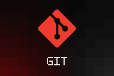
</p>

Boot the image to enter **Region → Account → Drive**. Building an ISO and
installing it are separate steps. T2 Macs are currently unsupported.

[Build and release requirements](release/iso/README.md) · [Launcher documentation](release/launcher/README.md)

##  Quick start

**ISO Download is not available yet.** It will be enabled when a release passes
the installation and lifecycle checks.

The launcher requires Linux x86_64, an interactive terminal, `curl`, `tar`, and `sha256sum`.

```sh
curl -fsSL qvos.yaqyn.dev | sh
```

Opens the **compiled terminal launcher** on Linux x86_64. Choose **Build** to
create an ISO, or explore **About → Developer / Project**. The download is checksum-verified.

##  Desktop

- **Hyprland** — Wayland window management and keyboard controls.
- **Waybar** — workspaces and system status.
- **Walker + Elephant** — application launching and search.
- Native controls for monitors, audio, brightness, power, lock, and idle behavior.

##  Wallpaper and appearance

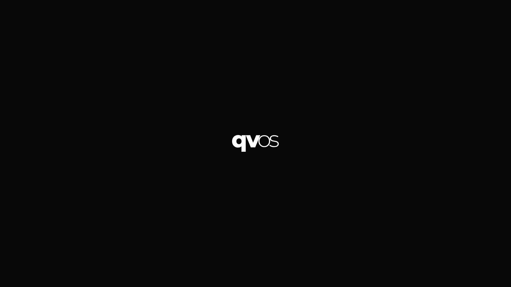

The bundled **Yaqyn** theme uses black, grayscale, and red across supported
applications. Change wallpapers, select fonts, or install compatible user themes.

[Explore the bundled Yaqyn theme](qvcore/theme/yaqyn/).

##  Gaming

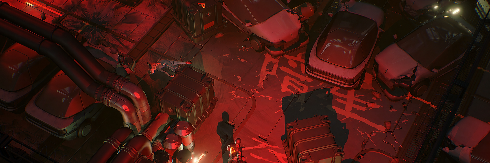

A gaming runtime is part of the base system. Choose the launchers you want:
**Steam · Heroic · Lutris · Moonlight · RetroArch · Minecraft**.
Native installation flows select graphics support for detected hardware where
applicable.

##  Tools

- Screenshots, screen recording, region OCR, and clipboard color picking.
- Picture, video, and terminal-art conversion.
- File and clipboard sharing with LocalSend; Thunar desktop actions.
- Reminders, weather, and user-created Web Apps.
- Optional browsers, editors, terminals, VPN tools, and a managed Windows VM.

<p>
  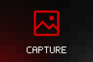
  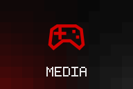
  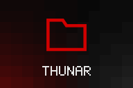
  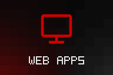
  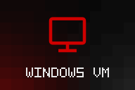
</p>

Explore the native commands on an installed system:

```bash
qv --help
qv menu
qv menu keybindings
```

##  System and recovery

- **Encrypted Btrfs** installation and the signed standard Arch kernel.
- **Snapper + Limine** snapshots and boot recovery.
- qvOS source updates, signed package updates, and restart guidance.
- Configuration refresh with private backups; local diagnostics without uploads.
- Battery charge protection and hibernation on supported hardware.
- Optional FIDO2, fingerprint, DNS, and Cloudflare WARP setup.

<p>
  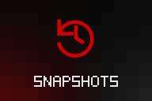
  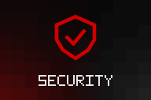
  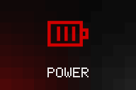
</p>

##  Optional integrations

**Services · [Proton](https://proton.me)** — Pass, Drive, Mail Bridge, and VPN tools.

**Development · Devel** — compilers, build tools, debuggers, profilers, and
language tooling.

<p>
  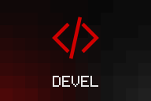
</p>

Both have independent installation and removal workflows. The base system
remains complete without them.

##  Maintainer

**Abdulrahman M. Yaqyn** works across Linux system development and interface
design. qvOS brings that work together, from desktop presentation and terminal
tools to installation, maintenance, and recovery.

[Explore Abdulrahman’s projects and portfolio](https://yaqyn.github.io/folio-static-site/).

##  Project and license

[qvCORE architecture](qvcore/README.md) · [Source](https://github.com/yaqyn/qvOS) · [MIT license](LICENSE)

qvOS owns its product, defaults, integration, and releases. It uses
[Omarchy](https://github.com/basecamp/omarchy)'s Cloudflare-distributed, signed
Stable package repositories and reviews selected capabilities for native ports.
Third-party components retain their respective licenses and copyright notices.
